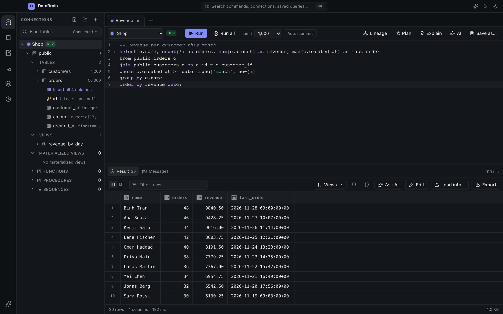
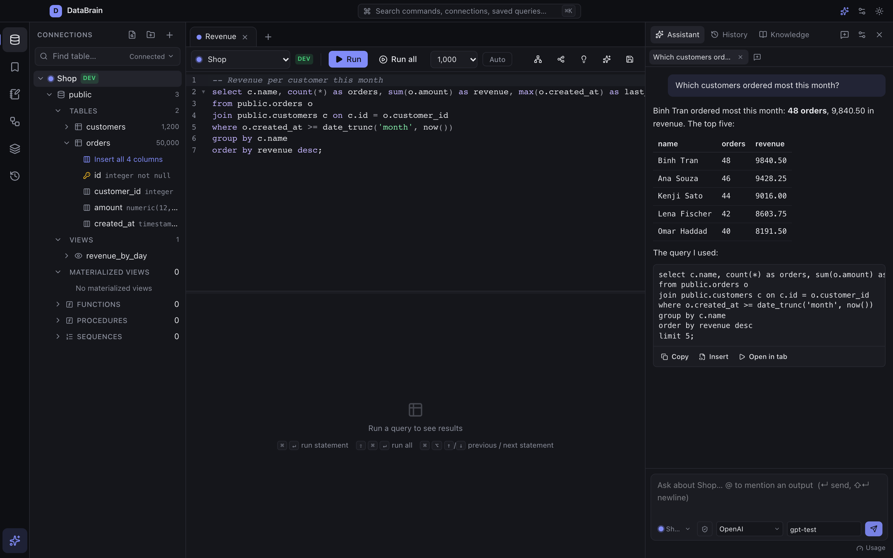
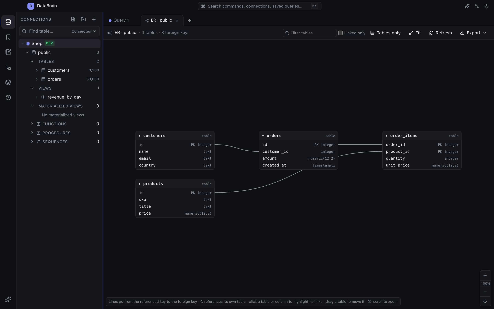
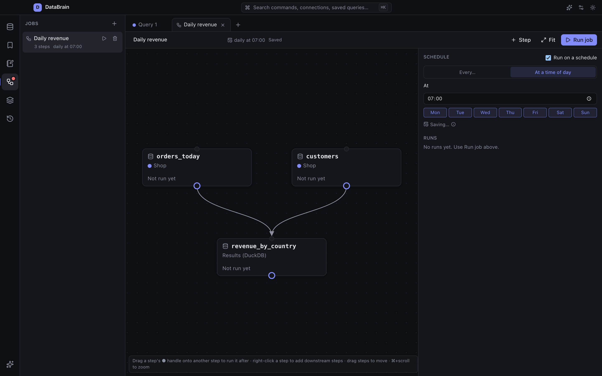

# DataBrain

A desktop SQL client for many databases, with column lineage, scheduled jobs and an AI assistant. Built with Rust, Tauri 2 and React.

[Download](#download) · [Features](docs/FEATURES.md) · [Architecture](docs/ARCHITECTURE.md) · [Building and releasing](docs/RELEASING.md) · [Changelog](CHANGELOG.md) · [Contributing](CONTRIBUTING.md) · [Security](SECURITY.md)



## Download

| Platform | Installer |
|---|---|
| macOS (Apple Silicon) | [DataBrain_0.3.0_aarch64.dmg](https://github.com/toan1804/databrain/releases/download/v0.3.0/DataBrain_0.3.0_aarch64.dmg) |
| macOS (Apple Silicon), without DuckDB | [DataBrain-no-duckdb_0.3.0_aarch64.dmg](https://github.com/toan1804/databrain/releases/download/v0.3.0/DataBrain-no-duckdb_0.3.0_aarch64.dmg) |
| macOS (Intel) | [DataBrain_0.3.0_x64.dmg](https://github.com/toan1804/databrain/releases/download/v0.3.0/DataBrain_0.3.0_x64.dmg) |
| Windows | [DataBrain_0.3.0_x64-setup.exe](https://github.com/toan1804/databrain/releases/download/v0.3.0/DataBrain_0.3.0_x64-setup.exe) |
| Linux (AppImage) | [DataBrain_0.3.0_amd64.AppImage](https://github.com/toan1804/databrain/releases/download/v0.3.0/DataBrain_0.3.0_amd64.AppImage) |
| Linux (Debian, Ubuntu) | [DataBrain_0.3.0_amd64.deb](https://github.com/toan1804/databrain/releases/download/v0.3.0/DataBrain_0.3.0_amd64.deb) |

All versions are on the [Releases](https://github.com/toan1804/databrain/releases) page, with a `SHA256SUMS` file to check downloads ([how](docs/RELEASING.md#checksums-and-provenance)). The app checks for updates once a day; signed releases install from its banner when you click Install (others link to the download).

> [!NOTE]
> Until a release is signed with a Developer ID (see [Signing](docs/RELEASING.md#signing-and-in-app-updates)), move DataBrain.app to Applications, then right-click it → **Open** the first time.

The "without DuckDB" build is about 85 MB instead of 290 MB and uses the DuckDB library installed on the computer (1.5 or newer, e.g. `brew install duckdb`).

## Screenshots

| AI assistant | ER diagram | Job canvas |
|---|---|---|
|  |  |  |

The screenshots are made from the UI with sample data (`cd ui && npm run screenshots`, Playwright against the mocked backend in `ui/e2e`).

## Features

- **Databases:** PostgreSQL, Amazon Redshift (with IAM sign-in through the AWS CLI), MySQL/MariaDB, SQL Server, Oracle, SQLite, ClickHouse, Snowflake, Databricks, BigQuery, DuckDB, MongoDB and Neo4j. Passwords are kept in the OS keychain. Supports browser sign-in, cloud CLI logins and SSH tunnels.
- **Local files:** query CSV, Parquet, JSON, Excel, Delta Lake and Iceberg files with DuckDB.
- **Explorer:** cached schemas that open at once and work offline, fast on catalogs with 10,000+ tables, DDL for every object, schema compare.
- **Editor:** dialect-aware completion and formatting, `:name` parameters, transactions, query plans, tips for slow queries, `.sql` files.
- **Results:** virtualized grid, cell editing, charts and dashboards, export to CSV, JSON, Parquet, XLSX and more.
- **Outputs:** every result gets a name you can query with DuckDB as `results.<name>`, to join data across databases, compare versions and pin results.
- **Lineage:** column lineage of SQL scripts, drawn as a diagram and exportable to draw.io, Mermaid, DOT, SVG or PNG.
- **Notebooks:** SQL and Markdown cells that share one session.
- **Jobs:** steps that query, load into another database or save files, on a schedule, with run logs, progress and resume after a failure.
- **AI assistant:** Kiro, OpenAI, Anthropic, Gemini, Azure OpenAI, OpenRouter, Ollama or LM Studio. It uses your schema and notes, runs queries only as each connection's policy allows, and reads and writes only the tables you permit.
- **MCP server:** `databrain-mcp` gives Kiro CLI, Claude Code, Cursor and other clients access to the connections you choose.

See [docs/FEATURES.md](docs/FEATURES.md) for the full reference.

## Build from source

Requirements:

- Rust 1.88+ and Node 22.22+ (Go 1.27+ only to build the Oracle driver helper)
- macOS: Xcode Command Line Tools · Linux: [Tauri prerequisites](https://v2.tauri.app/start/prerequisites/) · Windows: WebView2 and MSVC build tools

```sh
cd ui
npm install
npm run app:dev               # app with hot reload
npm run app:build             # release bundle for this platform
npm run app:build:no-duckdb   # bundle that uses the computer's DuckDB
```

## Test

```sh
cargo fmt --all -- --check                        # rustfmt.toml: 160 columns
cargo test --workspace
cargo clippy --workspace --all-targets
cargo deny check                                  # advisories, licenses, sources (deny.toml)
cd ui && npm run lint && npm test && npm run build
npx playwright install chromium && npm run e2e   # UI smoke tests (in ui/)
```

`npm run lint` is ESLint with the React hooks rules; a suppression must say why (`// eslint-disable-next-line rule -- reason`). `npm test` runs two Vitest projects: `unit` (`*.test.ts`, Node) and `dom` (`*.test.tsx`, components rendered with Testing Library in jsdom).

The UI smoke tests (`ui/e2e`, Playwright) run the app in Chromium against a mocked backend (`ui/e2e/tauri-mock.js` answers the Tauri commands from test data and lets a test push backend events): the explorer (tree, columns, ER diagram), the job canvas (adding and linking steps, step details, run progress) and the AI panel (streamed answers, approvals, errors).

The TypeScript types of what the backend sends are generated from the Rust types: `cargo test` writes them to `ui/src/lib/bindings` (commit them; CI checks they are current).

Tests that need a database server are marked `#[ignore]`, so `cargo test` lists them as ignored. Run them with `--ignored` and the server's `DATABRAIN_*` variables; a missing variable fails the test rather than skipping it:

```sh
DATABRAIN_PG_HOST=localhost DATABRAIN_PG_USER=postgres DATABRAIN_PG_PASSWORD=... \
  cargo test -p databrain-connector-postgres -- --ignored
```

The variables are `DATABRAIN_PG_*`, `DATABRAIN_MYSQL_*`, `DATABRAIN_MSSQL_*`, `DATABRAIN_ORACLE_*`, `DATABRAIN_SF_*`, `DATABRAIN_DBX_*`, `DATABRAIN_BQ_PROJECT`, `DATABRAIN_MONGO_URI`, `DATABRAIN_NEO4J_*`, `DATABRAIN_CLICKHOUSE_*`, `DATABRAIN_REDSHIFT_*` and `DATABRAIN_SSH_*`. CI runs the Postgres, MySQL, MongoDB and ClickHouse ones against service containers. A sample dataset for trying the app is in `examples/data`.

## Project layout

```
crates/
  app/             Tauri host and the databrain-mcp and databrain-jobs binaries
  query-engine/    sessions, query runs, cancel, safety checks, outputs, loads
  connectors/      one crate per database type
  connector-core/  connector traits, statement splitting and classification
  workspace/       local SQLite store: connections, history, notebooks, jobs
  ai/              AI providers, agent tools, knowledge index, MCP server
  lineage/         column lineage of SQL
  result-store/    in-memory Arrow results
  export/          file writers
  auth/            keychain and sign-in methods
  ssh-tunnel/      SSH tunnels
  duckdb-dynload/  DuckDB loaded at runtime (builds without bundled DuckDB)
ui/                React, TypeScript, Vite and Tailwind
```

To add a database type, see [docs/ARCHITECTURE.md](docs/ARCHITECTURE.md) §5.2 (source traits) and §5.4 (adding a database type).

## License

DataBrain is licensed under either of [Apache License, Version 2.0](LICENSE-APACHE) or [MIT license](LICENSE-MIT), at your option. Unless you state otherwise, any contribution you submit for inclusion is dual licensed as above, without additional terms or conditions.
