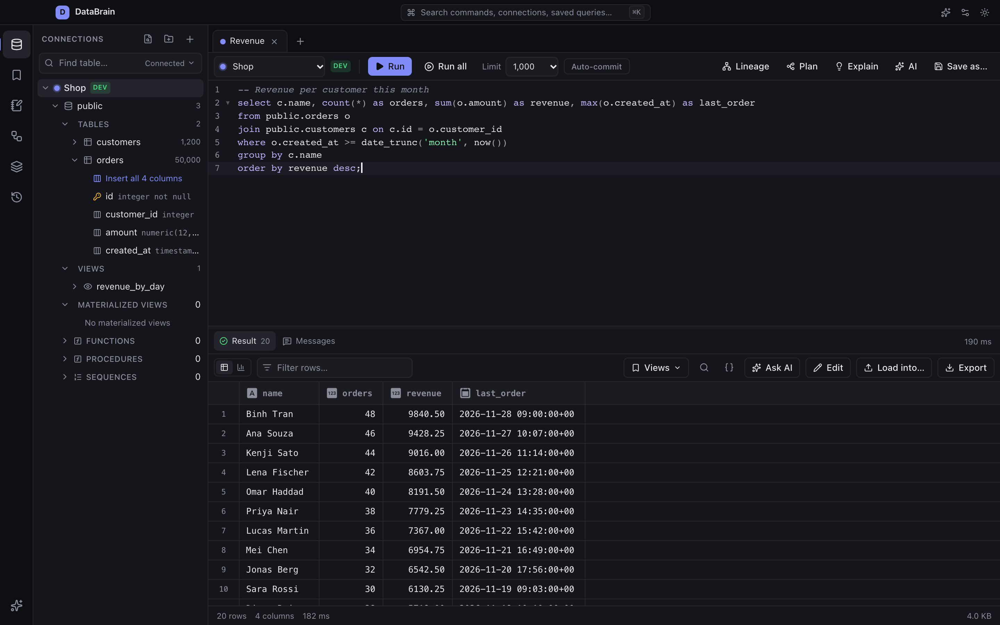
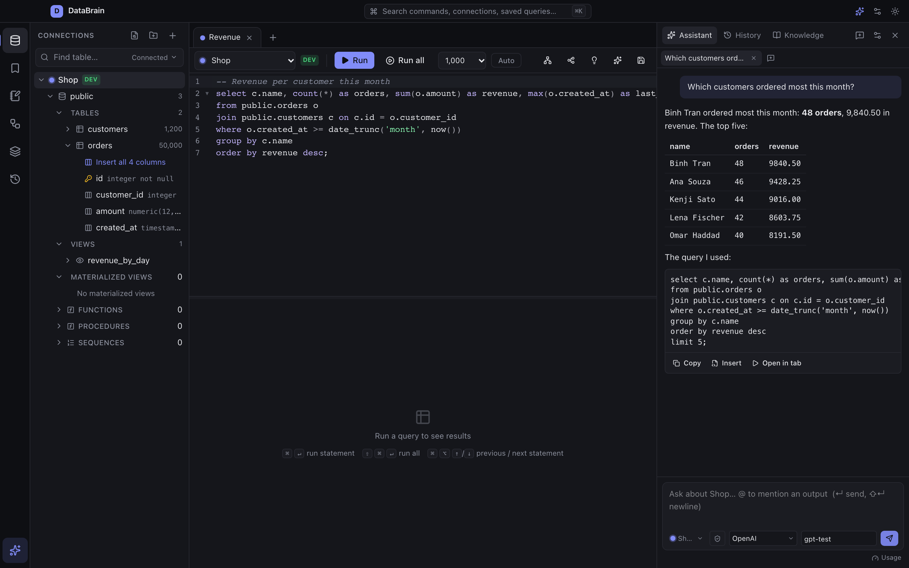
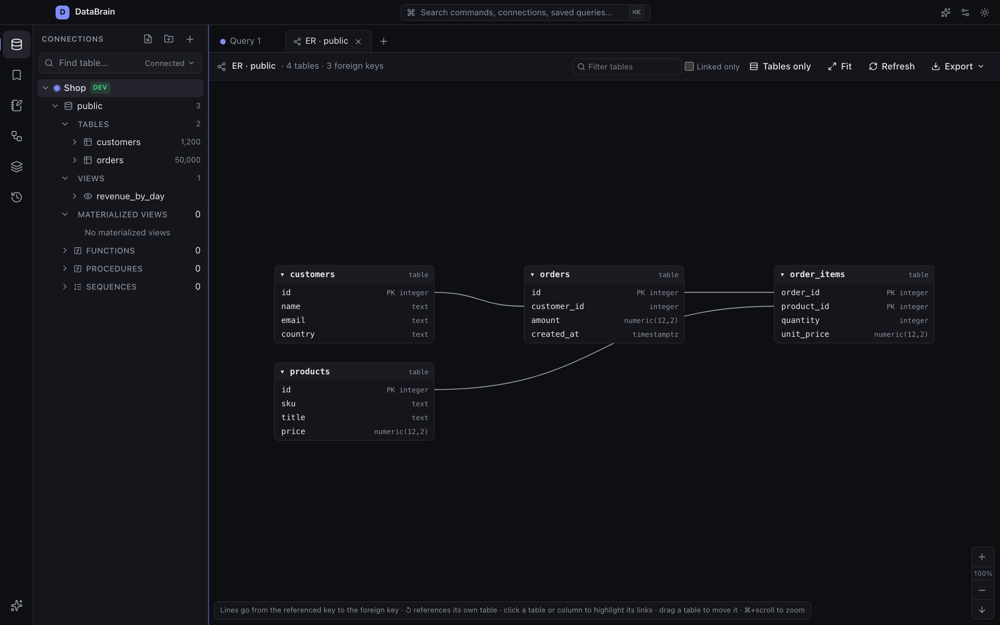
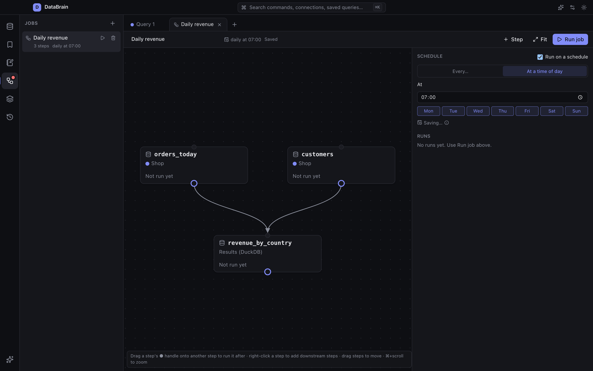

# DataBrain

A desktop SQL client for many databases, with column lineage, scheduled jobs and an AI assistant. Built with Rust, Tauri 2 and React.

[Download](#download) · [Features](docs/FEATURES.md) · [Architecture](docs/ARCHITECTURE.md) · [Building and releasing](docs/RELEASING.md) · [Changelog](CHANGELOG.md) · [Contributing](CONTRIBUTING.md) · [Security](SECURITY.md)



## Download

| Platform | Installer |
|---|---|
| macOS (Apple Silicon) | [DataBrain_0.5.2_aarch64.dmg](https://github.com/toan1804/databrain/releases/download/v0.5.2/DataBrain_0.5.2_aarch64.dmg) |
| macOS (Apple Silicon), without DuckDB | [DataBrain-no-duckdb_0.5.2_aarch64.dmg](https://github.com/toan1804/databrain/releases/download/v0.5.2/DataBrain-no-duckdb_0.5.2_aarch64.dmg) |
| macOS (Intel) | [DataBrain_0.5.2_x64.dmg](https://github.com/toan1804/databrain/releases/download/v0.5.2/DataBrain_0.5.2_x64.dmg) |
| Windows | [DataBrain_0.5.2_x64-setup.exe](https://github.com/toan1804/databrain/releases/download/v0.5.2/DataBrain_0.5.2_x64-setup.exe) |
| Windows (MSI) | [DataBrain_0.5.2_x64_en-US.msi](https://github.com/toan1804/databrain/releases/download/v0.5.2/DataBrain_0.5.2_x64_en-US.msi) |
| Linux (AppImage) | [DataBrain_0.5.2_amd64.AppImage](https://github.com/toan1804/databrain/releases/download/v0.5.2/DataBrain_0.5.2_amd64.AppImage) |
| Linux (Debian, Ubuntu) | [DataBrain_0.5.2_amd64.deb](https://github.com/toan1804/databrain/releases/download/v0.5.2/DataBrain_0.5.2_amd64.deb) |
| Linux (Fedora, RHEL) | [DataBrain-0.5.2-1.x86_64.rpm](https://github.com/toan1804/databrain/releases/download/v0.5.2/DataBrain-0.5.2-1.x86_64.rpm) |

All versions are on the [Releases](https://github.com/toan1804/databrain/releases) page, with a `SHA256SUMS` file to check downloads ([how](docs/RELEASING.md#checksums-and-provenance)). The app checks for updates once a day and installs one from its banner (**Update and relaunch**); Linux `.deb` and `.rpm` installs link to the download instead.

> [!NOTE]
> DataBrain isn't signed with an Apple Developer ID yet (see [Signing](docs/RELEASING.md#signing-and-in-app-updates)), so macOS blocks it the first time, or says it "is damaged and can't be opened". Move DataBrain.app to Applications, then clear the quarantine flag once in Terminal:
>
> ```sh
> sudo xattr -cr /Applications/DataBrain.app
> ```

The "without DuckDB" build is a 24 MB download instead of 78 MB and uses the DuckDB library installed on the computer (1.5 or newer, e.g. `brew install duckdb`).

## Screenshots

| AI assistant | ER diagram | Job canvas |
|---|---|---|
|  |  |  |

The screenshots are made from the UI with sample data (`cd ui && npm run screenshots`, Playwright against the mocked backend in `ui/e2e`).

## Features

- **Databases:** PostgreSQL, Amazon Redshift (with IAM sign-in through the AWS CLI), MySQL/MariaDB, SQL Server, Oracle, SQLite, ClickHouse, Snowflake, Databricks, BigQuery, DuckDB, MongoDB and Neo4j. Passwords are kept in the OS keychain. Supports browser sign-in, cloud CLI logins and SSH tunnels; Oracle needs no Instant Client (a small driver is downloaded on first use). Connections can be imported from DBeaver, DataGrip and `~/.pgpass`.
- **Local files:** query CSV, Parquet, JSON, Excel, Delta Lake and Iceberg files with DuckDB.
- **Explorer:** cached schemas that open at once and work offline, fast on catalogs with 10,000+ tables, DDL for every object, schema compare.
- **Editor:** dialect-aware completion and formatting, `:name` parameters, transactions, query plans, tips for slow queries, `.sql` files.
- **Results:** virtualized grid, cell editing, charts and dashboards, export to CSV, JSON, Parquet, XLSX and more. A result larger than the memory it may use continues on disk instead of being cut.
- **Outputs:** every result gets a name you can query with DuckDB as `results.<name>`, to join data across databases, compare versions and pin results.
- **Lineage:** column lineage of SQL scripts, drawn as a diagram and exportable to draw.io, Mermaid, DOT, SVG or PNG.
- **Notebooks:** SQL and Markdown cells that share one session.
- **Jobs:** steps that query, load into another database or save files, on a schedule, with run logs, progress and resume after a failure.
- **AI assistant:** Kiro, OpenAI, Anthropic, Gemini, Azure OpenAI, OpenRouter, Ollama, LM Studio or any OpenAI-compatible server. It uses your schema and notes, runs queries only as each connection's policy allows, and reads and writes only the tables you permit.
- **MCP server:** `databrain-mcp` gives Kiro CLI, Claude Code, Cursor and other clients access to the connections you choose.

See [docs/FEATURES.md](docs/FEATURES.md) for the full reference.

## Command line

`dbr` opens data files and SQL in DataBrain, or (`-i`) runs SQL from a terminal on a saved connection, with its credentials and safety rules, and prints the rows:

```sh
dbr orders.csv                                           # the file's rows in a tab of the running app
dbr -c Sales --run report.sql                            # the file in its tab, run on "Sales"
dbr -c Sales -i "select * from orders limit 10"          # a table as wide as the terminal
dbr -c Sales -i report.sql -p day=2026-11-20             # a .sql file, :day filled in
dbr -c Sales -i --csv "select * from orders" > out.csv   # every row (also --json, --tsv)
dbr -i data.parquet orders.xlsx events/                  # local files, read with DuckDB
dbr jobs list                                            # jobs: list, run, runs, stop
dbr --help                                               # every option; dbr --version
```

Without `-i`, the running DataBrain (started when it isn't) opens each file or SQL in its own tab: a data file's rows as a result, a `.sql` file in its file tab (run too with `--run`), SQL run on the connection as the editor runs it. `-c` takes the connection's name (in any case) or its id, checked before anything runs; a typo or a part of a name is refused with the close names offered (`dbr --connections` lists them); without it, `dbr` uses the local DuckDB. `--limit n` caps the rows (a table shows 100 by default). It runs as the app's editor does: a read-only connection refuses writes, what the app would confirm on a production connection is asked as `[y/N]` (refused without a terminal unless `--yes`), and every run is in the query history as "Terminal". Settings → Terminal → "Install the dbr command" puts it on your PATH (a link `/usr/local/bin/dbr` on macOS, the install folder on your PATH on Windows, a script in `~/.local/bin` for the AppImage; the Linux `.deb` and `.rpm` install `/usr/bin/dbr` themselves). It is `DataBrain.app/Contents/MacOS/dbr` on macOS and in the install folder on Windows. Exit codes: 0 done (or opened in the app), 1 a statement failed, 2 bad arguments, a question answered no or the app not reached, 130 stopped. More in [docs/FEATURES.md](docs/FEATURES.md) (`dbr` (terminal)).

## Build from source

Requirements:

- Rust 1.89+ and Node 22.22+ (Go 1.27+ only to build the Oracle driver helper)
- macOS: Xcode Command Line Tools · Linux: [Tauri prerequisites](https://v2.tauri.app/start/prerequisites/) · Windows: WebView2 and MSVC build tools

```sh
cd ui
npm install
npm run app:dev               # app with hot reload
npm run app:build             # release bundle for this platform
npm run app:build:no-duckdb   # bundle that uses the computer's DuckDB
```

## Test

```sh
cargo fmt --all -- --check                        # rustfmt.toml: 160 columns
cargo test --workspace
cargo clippy --workspace --all-targets
cargo +1.89 check --workspace --all-targets          # the minimum Rust version
cargo run --release -p databrain-bench -- engine/   # speed of the critical paths (docs/PERFORMANCE.md)
cargo deny check                                  # advisories, licenses, sources (deny.toml)
cd ui && npm run lint && npm test && npm run build
npx playwright install chromium && npm run e2e   # UI smoke tests (in ui/)
```

`npm run lint` is ESLint with the React hooks rules; a suppression must say why (`// eslint-disable-next-line rule -- reason`). `npm test` runs two Vitest projects: `unit` (`*.test.ts`, Node) and `dom` (`*.test.tsx`, components rendered with Testing Library in jsdom).

The UI smoke tests (`ui/e2e`, Playwright) run the app in Chromium against a mocked backend (`ui/e2e/tauri-mock.js` answers the Tauri commands from test data and lets a test push backend events): the explorer (tree, columns, ER diagram), the editor and result tabs, grid edits (the production prompt, Backspace, multi-block selections), output compare, the job canvas (steps, links, runs, the assistant changing a job), Knowledge, the AI panel (streamed answers, approvals, errors), settings and toolbars.

The TypeScript types of what the backend sends are generated from the Rust types: `cargo test` writes them to `ui/src/lib/bindings` (commit them; CI checks they are current).

Tests that need a database server are marked `#[ignore]`, so `cargo test` lists them as ignored. Run them with `--ignored` and the server's `DATABRAIN_*` variables; a missing variable fails the test rather than skipping it:

```sh
DATABRAIN_PG_HOST=localhost DATABRAIN_PG_USER=postgres DATABRAIN_PG_PASSWORD=... \
  cargo test -p databrain-connector-postgres -- --ignored
```

The variables are `DATABRAIN_PG_*`, `DATABRAIN_MYSQL_*`, `DATABRAIN_MSSQL_*`, `DATABRAIN_ORACLE_*`, `DATABRAIN_SF_*`, `DATABRAIN_DBX_*`, `DATABRAIN_BQ_PROJECT`, `DATABRAIN_MONGO_URI`, `DATABRAIN_NEO4J_*`, `DATABRAIN_CLICKHOUSE_*`, `DATABRAIN_REDSHIFT_*` and `DATABRAIN_SSH_*`. CI runs the Postgres, MySQL, MongoDB and ClickHouse ones against service containers. A sample dataset for trying the app is in `examples/data`.

## Project layout

```
crates/
  app/             Tauri host (also `databrain mcp` / `databrain jobs`) and the databrain-mcp and databrain-jobs launchers
  query-engine/    sessions, query runs, cancel, safety checks, outputs, loads
  connectors/      one crate per database type (oracle/agent: the Go driver helper)
  connector-core/  connector traits, statement splitting and classification
  workspace/       local SQLite store: connections, history, notebooks, jobs
  ai/              AI providers, agent tools, knowledge index, MCP server
  lineage/         column lineage of SQL
  result-store/    Arrow results, in memory and continued on disk
  export/          file writers
  auth/            keychain and sign-in methods
  ssh-tunnel/      SSH tunnels
  duckdb-dynload/  DuckDB loaded at runtime (builds without bundled DuckDB)
  bench/           timings of the critical paths
ui/                React, TypeScript, Vite and Tailwind
```

To add a database type, follow [docs/ADDING_A_CONNECTOR.md](docs/ADDING_A_CONNECTOR.md); [docs/ARCHITECTURE.md](docs/ARCHITECTURE.md) §5 explains the connector layer.

## License

DataBrain is licensed under either of [Apache License, Version 2.0](LICENSE-APACHE) or [MIT license](LICENSE-MIT), at your option. Unless you state otherwise, any contribution you submit for inclusion is dual licensed as above, without additional terms or conditions.
